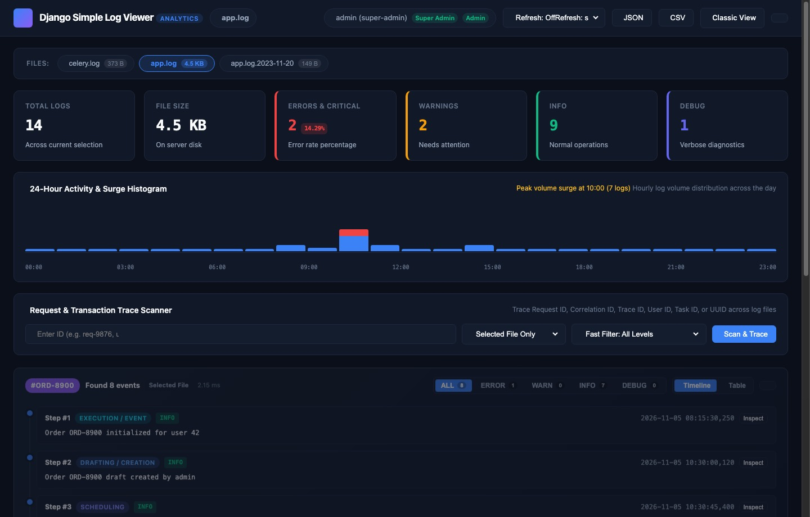

========================
Django Simple Log Viewer
========================

**Django Simple Log Viewer** is a high-performance, intuitive log analytics dashboard and log viewer for Django applications. It automatically discovers, parses, and provides real-time monitoring, KPI analytics, 24-hour traffic activity histograms, correlation/entity trace timelines, payload sanitization, and raw log inspection across your application logs.

Features
========

- **Zero-Fuss Integration**: Discovers log files and formatters directly from your standard Django ``LOGGING`` configuration.
- **Log Analytics Dashboard**:
  - **KPI Metrics Cards**: Total logs, file sizes, error counts, error rate percentage, warning, info, and debug counts.
  - **24-Hour Activity & Surge Histogram**: Visual hourly traffic distribution across the day with error highlights and peak volume surge alerts.
  - **File Switcher Bar**: Visual interactive pill buttons displaying each available log file with file size badges for quick one-click switching.
  - **Auto-Refresh**: Live polling intervals (off, 5s, 10s, 30s, 60s) with spinning status indicators.
- **Request & Transaction Trace Scanner**:
  - Trace any ID across logs: Request ID, Correlation ID, Trace ID, User ID, Task ID, Order ID, or UUID.
  - Date Scoping: Selected log file, all available files, or custom date range (start to end date).
  - Fast Mode / Severity pre-filtering: target specific log levels (e.g. ``ERROR``) to accelerate scans.
  - **Lifecycle Event Timeline**: Automatically maps log events to structured lifecycle stages (Drafting/Creation, Scheduling, Approval, Queue & Processing, Dispatch/Delivery, Completion, Failures/Errors) with color-coded stage badges and interactive step inspection.
- **Massive Payload Sanitization & DOM Protection**:
  - Automatically redacts voluminous JSON dumps, base64 blobs, and large arrays into concise interactive indicator pills in the list view (e.g. ``[/* 📦 Array (500 items) stripped */]``, ``[/* 📦 Object (8,109 chars) stripped */]``).
  - Full raw payload is preserved and viewable on-demand in the **Log Detail Modal** with one-click JSON formatting and clipboard copying.
  - Sensitive credentials masking (Authorization Bearer tokens, passwords).
- **Fast Filtering & Search**: Instant severity tabs (ALL, ERROR, WARN, INFO, DEBUG), real-time debounced keyword search with match highlighting, and pagination.
- **Export Capabilities**: Export filtered logs as JSON or CSV directly from the dashboard.
- **Universal Log Format Support**:
  - Supports ``%``-style (``%(asctime)s``), ``{``-style (``{asctime}``), and ``$``-style (``$asctime``) formatters.
  - Automatically parses bracketed timestamps (``[%(asctime)s]``), hyphen delimiters, colons, and padded levels (``%(levelname)-8s``).
  - Handles Django documentation's recommended formats seamlessly (including ``{process:d}``, ``{thread:d}``).
- **Multiline Traceback Preservation**: Multi-line error stack traces and exceptions are automatically attached to their corresponding log entries and rendered cleanly with preserved formatting.
- **Rotated Logs Support**: Seamlessly browses rotated log archives (e.g. ``app.log.1``, ``app.log.2023-11-22``).
- **Pathlib & Relative Path Support**: Works seamlessly with ``pathlib.Path`` objects (e.g., ``BASE_DIR / 'logs' / 'app.log'``) and relative paths.
- **Secure Access Control (RBAC)**: Restricted to superusers by default, or fully customizable with custom permission functions and staff controls.
- **Dual View Modes**: Sleek dark-mode Analytics Dashboard by default with instant toggle to Classic DataTables view.

Compatibility
=============

- **Python**: 3.11, 3.12, 3.13+
- **Django**: 4.2 (LTS), 5.0, 5.1, 5.2+

Installation
============

Install via pip::

    pip install django-simple-log-viewer

Quick Start
===========

1. Add ``log_viewer`` to your ``INSTALLED_APPS`` in ``settings.py``:

   .. code-block:: python

       INSTALLED_APPS = [
           ...,
           'log_viewer',
       ]

2. Add the log viewer to your project's ``urls.py``:

   .. code-block:: python

       from django.urls import path, include

       urlpatterns = [
           ...,
           path('log-viewer/', include('log_viewer.urls')),
       ]

3. Configure a file-based handler in your ``LOGGING`` setting in ``settings.py`` (if you haven't already):

   .. code-block:: python

       from pathlib import Path
       BASE_DIR = Path(__file__).resolve().parent.parent

       LOGGING = {
           'version': 1,
           'disable_existing_loggers': False,
           'formatters': {
               'verbose': {
                   'format': '{levelname} {asctime} {module} {process:d} {thread:d} {message}',
                   'style': '{',
               },
               'standard': {
                   'format': '%(asctime)s [%(levelname)s] %(name)s: %(message)s',
               },
           },
           'handlers': {
               'file': {
                   'level': 'DEBUG',
                   'class': 'logging.FileHandler',
                   'filename': BASE_DIR / 'app.log',
                   'formatter': 'standard',
               },
           },
           'loggers': {
               '': {
                   'handlers': ['file'],
                   'level': 'INFO',
                   'propagate': True,
               },
           },
       }

4. Log in as a **superuser** and visit ``/log-viewer/`` in your browser.

Settings Configuration
======================

Every behavior and tweak of the log dashboard can be configured in your ``settings.py``:

.. list-table::
   :widths: 35 20 45
   :header-rows: 1

   * - Setting
     - Default
     - Description
   * - ``LOG_VIEWER_PAGE_SIZE``
     - ``50``
     - Default number of log rows per page.
   * - ``LOG_VIEWER_DEFAULT_THEME``
     - ``'dark'``
     - Default UI theme (``'dark'`` or ``'light'``).
   * - ``LOG_VIEWER_AUTO_REFRESH_INTERVALS``
     - ``[0, 5, 10, 30, 60]``
     - Available auto-refresh options in seconds (0 = Off).
   * - ``LOG_VIEWER_DEFAULT_AUTO_REFRESH``
     - ``0``
     - Initial auto-refresh interval.
   * - ``LOG_VIEWER_SANITIZATION_ENABLED``
     - ``True``
     - Strips massive payloads (large collections, huge JSON blobs) from table views.
   * - ``LOG_VIEWER_PAYLOAD_MAX_LENGTH``
     - ``250``
     - Max inline string length before truncation pill in list views.
   * - ``LOG_VIEWER_ARRAY_MAX_ITEMS``
     - ``5``
     - Max items shown in inline arrays before collapsing into a pill.
   * - ``LOG_VIEWER_SUPERUSER_ONLY``
     - ``True``
     - Restrict access strictly to superusers (``is_superuser``). Set to ``False`` to allow staff.
   * - ``LOG_VIEWER_PERMISSIONS_CHECK``
     - ``None``
     - Custom callable or import string ``"app.auth.check_perm"`` taking ``(user, request) -> bool``.
   * - ``LOG_VIEWER_EXCLUDE_FILES``
     - ``[]``
     - List of file names or substrings to exclude from the viewer (e.g. ``['secret.log']``).
   * - ``LOG_VIEWER_HOURLY_CHART_ENABLED``
     - ``True``
     - Enable or disable the 24-hour traffic activity histogram.
   * - ``LOG_VIEWER_REVERSE_ORDER``
     - ``True``
     - Show newest log entries first.
   * - ``LOG_VIEWER_CACHE_ENABLED``
     - ``True``
     - Enable in-memory LRU caching for overview stats.
   * - ``LOG_VIEWER_CACHE_TIMEOUT``
     - ``15``
     - Invalidation timeout in seconds for overview cache.
   * - ``LOG_VIEWER_FILE_SEARCH_DIRECTORIES``
     - ``[]``
     - Additional filesystem paths to scan for log files.
   * - ``SITE_NAME``
     - ``'LogViewer'``
     - Brand name displayed in the dashboard header.
   * - ``LOG_FILE_EXTENSION``
     - ``'.log'``
     - File extension filter for log archives.

Custom Entity / Correlation Patterns
------------------------------------

To add custom regexes for auto-extracting entity/trace IDs:

.. code-block:: python

    LOG_VIEWER_ENTITY_PATTERNS = [
        r'(?i)\b(?:request|request_id|trace_id)[\s:=#]+([a-zA-Z0-9_\-]+)',
        r'(?i)\b(?:correlation|correlation_id)[\s:=#]+([a-zA-Z0-9_\-]+)',
        r'(?i)\b(?:user|user_id)[\s:=#]+([a-zA-Z0-9_\-]+)',
        r'#([a-zA-Z0-9_\-]+)',
    ]

Custom Lifecycle Stages
-----------------------

Configure how unstructured logs map to chronological lifecycle timeline stages:

.. code-block:: python

    LOG_VIEWER_LIFECYCLE_STAGES = [
        {'name': 'Creation', 'color': 'blue', 'keywords': ['create', 'created', 'init']},
        {'name': 'Queueing', 'color': 'cyan', 'keywords': ['queue', 'queued', 'worker']},
        {'name': 'Processing', 'color': 'indigo', 'keywords': ['process', 'running']},
        {'name': 'Dispatch', 'color': 'teal', 'keywords': ['send', 'sent', 'broadcast']},
        {'name': 'Completion', 'color': 'green', 'keywords': ['success', 'completed', 'done']},
        {'name': 'Errors', 'color': 'red', 'keywords': ['fail', 'failed', 'error', 'fatal']},
    ]

REST API Endpoints Reference
============================

All API endpoints inherit your RBAC permissions and return JSON:

.. list-table::
   :widths: 15 35 50
   :header-rows: 1

   * - Method
     - Endpoint
     - Description
   * - ``GET``
     - ``/api/overview/``
     - Returns KPIs, severity breakdown, and 24-hour hourly traffic distribution.
   * - ``GET``
     - ``/api/logs/``
     - Paged query for sanitized log rows with level and keyword filtering.
   * - ``GET``
     - ``/api/scan/``
     - Entity/correlation scanner across single file, all files, or date range with lifecycle mapping.
   * - ``GET``
     - ``/api/detail/``
     - Returns complete un-sanitized raw payload and formatted JSON for inspection.
   * - ``GET``
     - ``/api/files/``
     - Returns list of all available log files and metadata.
   * - ``GET``
     - ``/api/export/``
     - Exports filtered logs as a downloadable JSON or CSV file.

Running Tests
=============

To run the test suite:

.. code-block:: bash

    python3 runtests.py

License
=======

Released under the `MIT License <LICENSE>`_.
